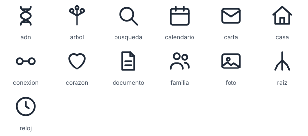

# Marketing — Genealogía

Textos y recursos gráficos de **conce.com**, el árbol genealógico. El etiquetador POS, Contrastocolor, tiene su propia marca y no usa estos textos.

- [`frases.md`](frases.md): lemas, eslóganes, redes sociales, correo y manifiesto. Empieza con una nota «Antes de usar» (las frases que afirman algo sobre la persona o su árbol están marcadas como condicionales).
- [`idiomas/`](idiomas/): traducciones de la parte madura de `frases.md` a 15 idiomas (borrador sin revisión nativa).
- [`logo/`](logo/): símbolo del árbol genealógico, en color y monocromo (`currentColor`; las ramas y los nodos son huecos, así que se ve igual sobre cualquier fondo).
- [`imagenes/`](imagenes/): banner para redes sociales (1200×630).
- [`iconos/`](iconos/): 13 íconos de trazo, 24×24, que heredan el color con `currentColor`.



`iconos/vista-previa.svg` es una hoja generada: fija el color según el modo claro u oscuro, porque un ícono con `currentColor` cargado como imagen sale siempre negro. Los íconos no cambian y siguen heredando el color cuando se usan en línea. Al añadir o cambiar un ícono, regenerarla con `php marketing/iconos/vista-previa.php`.

## Nombre de la marca

El nombre de la marca no está escrito en ninguna frase: los textos llevan el marcador `[Marca]` y el nombre se define una sola vez en [`config.json`](config.json).

```json
{
  "marca": "conce.com",
  "marca_por_idioma": {}
}
```

- `marca`: el nombre, obligatorio. Hoy vale `conce.com`. Si se vaciara, el script fallaría a propósito para que nadie publique el marcador sin sustituir.
- `marca_por_idioma`: opcional, hoy vacío. Sirve para escribir la marca de otra forma en un idioma, por ejemplo transliterada: `{"ja": "…", "ar": "…"}`. Las claves son los códigos de `idiomas/` (`es` para `frases.md`); un código desconocido es un error. `conce.com` es una dirección web y se deja en alfabeto latino en todos los idiomas, también en los de escritura no latina.
- Aparece una sola vez por idioma, en la despedida del correo (`Con cariño, el equipo de conce.com.`), y nunca al inicio de una oración, así que va en minúsculas tal como se escribe la marca.
- El sitio de genealogía de `url-routing/` muestra la marca en su cabecera, pero la lee de su propio `.env` (`SITE_NAME_GENEALOGY`, ver `url-routing/.env.example`), porque son proyectos independientes. Si cambia aquí, cámbiese también allí.

```bash
php marketing/render.php            # genera copias con la marca en marketing/dist/ (ignorado por git)
php marketing/render.php --check    # valida config.json y no escribe nada
```

Los archivos de origen nunca se modifican; el script se niega a escribir sobre ellos. El valor se inserta tal cual, así que si luego lo pegas en HTML, escápalo.

`[Nombre]` no lo toca el script: es por destinatario y lo rellena quien envía cada mensaje.
