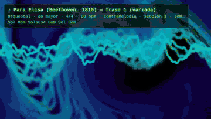
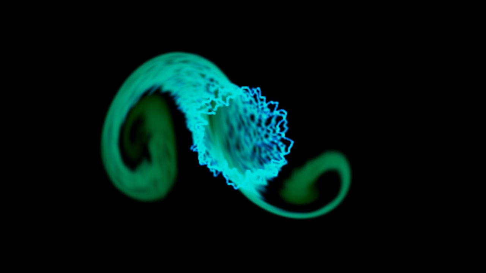
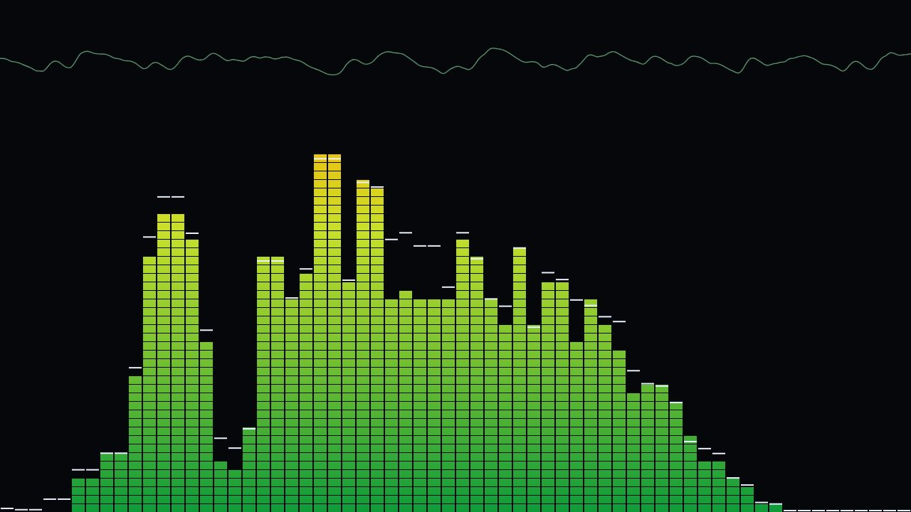
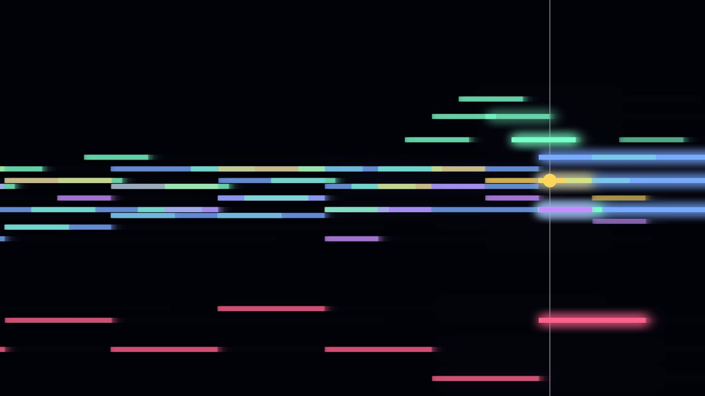
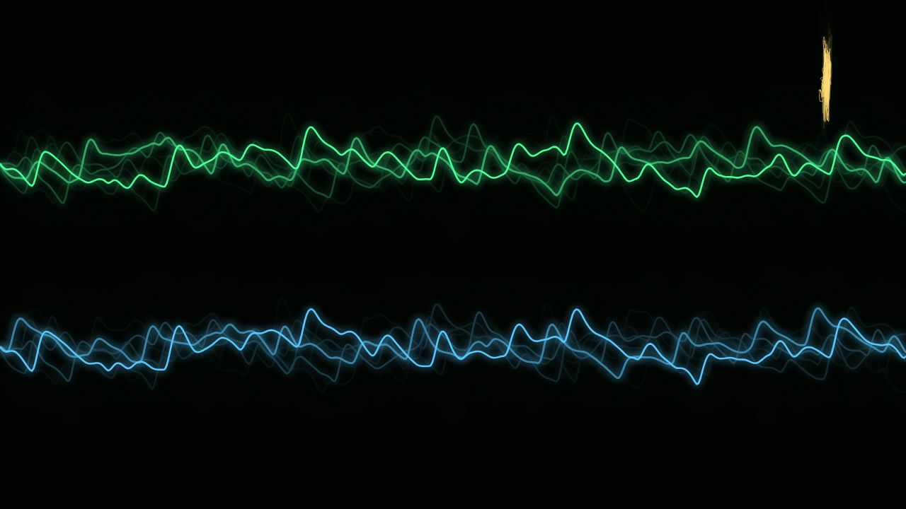
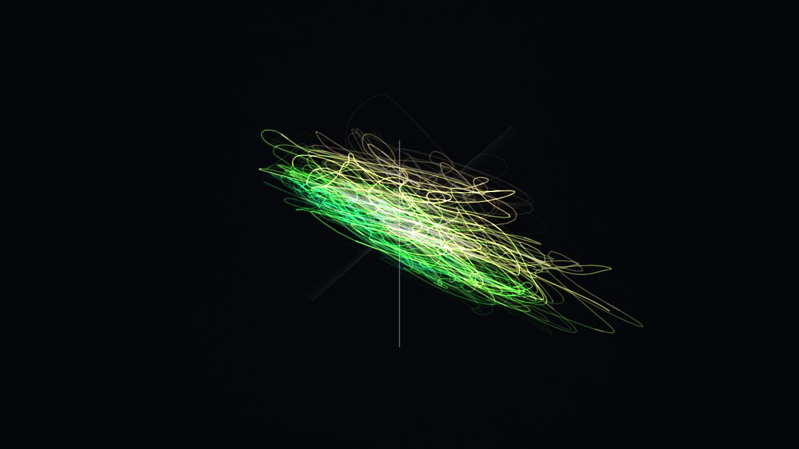
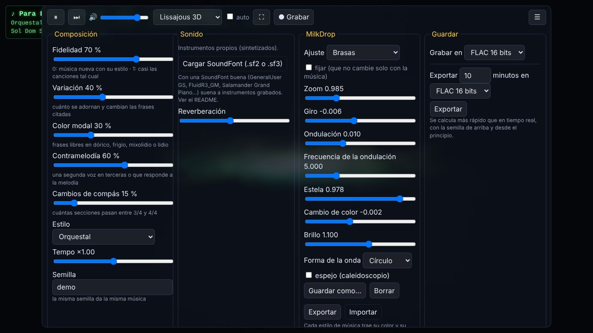

# Música infinita

Aplicación personal de música que no se acaba, hecha con las melodías de tus propios MIDI, y con visualizaciones al estilo de Winamp. Funciona en el navegador, sin servidor, sin dependencias y sin cuentas. Lo que cargues (MIDI y SoundFont) se queda en tu navegador.



- **Música infinita.** Aprende de las canciones que marques y compone sin parar. Va por secciones con su tonalidad, su tempo, su compás, su estilo y una forma (A A' B A…). Cita frases reales de tus canciones, llevadas a la tonalidad del momento y a veces adornadas, y las mezcla con frases nuevas al estilo de esas mismas canciones. Entre secciones modula (a la relativa, a la dominante, un tono más arriba…), y las frases libres pueden sonar en dórico, frigio, mixolidio o lidio. Cada frase cierra con su cadencia, y una segunda voz (la contramelodía) acompaña a la melodía.
- **Buen sonido.** Trae instrumentos propios sintetizados en el navegador: piano aditivo, piano eléctrico FM, cuerdas pulsadas Karplus-Strong, campanas, cuerdas frotadas, pads, coro, vientos y batería. Si cargas una **SoundFont** (`.sf2` o `.sf3`), suena con muestras de instrumentos reales. La mezcla pasa por reverberación de convolución, eco sincronizado con el tempo, un nivelador de sonoridad, un compresor y un limitador. El nivelador (una compresión lenta y fuerte) evita que una sección suene mucho más fuerte que otra: medido en LUFS, la diferencia entre los seis estilos y varias semillas baja de 6,6 a unos 3 LU, con el promedio en −13,5 LUFS y los picos por debajo de −1,3 dBFS.
- **Visualizaciones.** Son seis: la **MilkDrop** (WebGL2: cada cuadro se dibuja sobre el anterior, acercado, girado y deformado, con la onda encima), el **espectro** clásico de barras con los picos que caen, el **osciloscopio** (con Lissajous), una **lluvia de notas** que muestra qué toca cada voz y lo que viene, **partículas** que nacen de cada nota y de cada golpe de bombo, y una curva de **Lissajous 3D** que gira con la señal estéreo. Siguen a la música: cada estilo trae su color y su grupo de ajustes de la MilkDrop, que cambian al empezar cada sección.
- **Calidad sin pérdida.** Puedes grabar lo que suena en **FLAC** de 16 o 24 bits, o exportar los minutos que quieras en FLAC, WAV o MIDI. La exportación se calcula más rápido que el tiempo real y siempre da la misma música con la misma semilla.

| | |
|---|---|
|  |  |
|  |  |
|  |  |

## Uso

Abre `index.html` en el navegador (Chrome, Edge o Firefox; no hace falta servidor) y pulsa **Empezar**. Suena primero con siete melodías de ejemplo de dominio público. Para que suene con las tuyas:

1. Abre el panel con **☰**.
2. En «Biblioteca», usa **Cargar MIDI** o **Cargar carpeta**, o arrastra los `.mid` a la ventana.
3. Marca las canciones que quieras en la mezcla. Cuando hay MIDI propios, los ejemplos empiezan desmarcados.

Cada canción muestra la tonalidad, el tempo, el compás y la cantidad de frases que se detectaron. **▶ tal cual** toca el MIDI sin cambiarlo, con el mismo sintetizador y las mismas visualizaciones. Cuando termina, sigue la música infinita. Si un MIDI no suena como esperabas al citarlo, mira la [guía de MIDI](docs/GUIA-MIDI.md): explica cómo elige la melodía y cómo prepararlo.

**Elegir la pista de la melodía.** Cuando un MIDI tiene más de una pista con notas, su fila trae un selector: «Melodía: automática (pista 2 «Melody»…)» y, debajo, cada pista con su canal, su cantidad de notas y su registro. Elige la que de verdad lleva la melodía y la canción se vuelve a analizar al instante (frases, y citas desde la próxima sección). La última opción, «todas las pistas juntas», toma la línea superior del conjunto: sirve cuando la melodía pasa de un instrumento a otro. La tonalidad y los acordes se siguen detectando de todo el archivo. La elección queda guardada en tu navegador y vuelve a «automática» con la primera opción del selector. Si una pista no tiene una melodía que se pueda usar, avisa y se queda la automática.



| Ajuste | Qué hace |
|---|---|
| Fidelidad | Cuántos bloques son citas de tus canciones. Con 1 suena casi a las canciones tal cual; con 0, todo es música nueva con su estilo. |
| Variación | Cuánto se transforman las citas: notas de paso, ritmo con puntillo, octava, otro final, inversión. |
| Color modal | Con qué frecuencia una sección toca sus frases libres en un modo (dórico, frigio, mixolidio o lidio, según sea mayor o menor la canción de la que parte). Las citas conservan el modo de su canción. |
| Contramelodía | Cuántas secciones llevan una segunda voz: en terceras por debajo de la melodía, o que le responde en sus silencios. 60 % es lo que trae cada estilo; 0 la quita. |
| Cambios de compás | Cuántas secciones pasan de 3/4 a 4/4 o al revés. Sin cambio, cada sección toma el compás de su canción. |
| Estilo | Ambiente, Pop, Orquestal, Chiptune, Lo-fi o Cajita de música (cambian los instrumentos y los patrones del acompañamiento). En «Automático» cambia de vez en cuando. |
| Tempo | Multiplica el tempo de las canciones. |
| Semilla | La misma semilla da la misma música. Vacía, sale una al azar, y la pantallita muestra cuál fue. |

Atajos de teclado: **espacio** reproduce o pausa, **N** pasa a otra sección (o sale del modo «tal cual»), **V** cambia de visualización, **P** cambia el ajuste de la MilkDrop, **F** pone la pantalla completa, **R** graba y **H** oculta el panel. El panel también se esconde solo cuando no mueves el ratón.

### Ajustes de la MilkDrop

En el panel, «MilkDrop» deja elegir uno de los 12 ajustes de fábrica y editar en vivo su zoom, giro, ondulación, estela, color, brillo, la forma de la onda y el espejo. **Guardar como…** guarda el actual con tu nombre (queda en el navegador), **Borrar** quita uno propio, **Exportar** descarga tus ajustes en un JSON e **Importar** carga los de otra persona: los valores fuera de rango se recortan y lo inválido se descarta, con un aviso. **Fijar** evita que cambien solos al empezar cada sección. Cada estilo tiene su grupo de ajustes y su color: Ambiente va con azules y verdes y ajustes lentos, Pop con magentas y ajustes de pulso, Orquestal con dorados, Chiptune con verdes neón, Lo-fi con naranjas, y Cajita de música con lilas.

### Mejor sonido: una SoundFont

Los instrumentos propios suenan bien, pero una SoundFont con muestras grabadas suena mucho mejor. Algunas libres y buenas (búscalas por su nombre):

- **GeneralUser GS**: los 128 instrumentos General MIDI y la batería, en unos 30 MB. Es la más equilibrada.
- **FluidR3_GM** (licencia MIT): General MIDI completa, unos 140 MB.
- **MuseScore_General** (licencia MIT): la de MuseScore, General MIDI completa, también en versión `.sf3` (comprimida, mucho más chica).
- **Salamander Grand Piano**, en versión `.sf2`: un piano de cola muy bueno, solo piano.

Cárgala con **Cargar SoundFont** o arrastrándola a la ventana. Queda guardada en el navegador para la próxima vez. Si a la SoundFont le falta un instrumento, ese instrumento suena con el sintetizador propio.

Del formato se usan los rangos, el bucle, la afinación, la atenuación, el paneo, la envolvente de volumen, el filtro, la reverberación, la clase exclusiva, el vibrato y el LFO de modulación (a la afinación, al filtro y al volumen), la envolvente de modulación (a la afinación y al filtro) y los moduladores del archivo cuya fuente es la velocidad o la nota, con sus cuatro curvas. La velocidad actúa como en la norma: la amplitud sube como (v/127)² y el filtro se abre. Las muestras izquierda y derecha enlazadas se separan a los lados si la zona no trae paneo. Las `.sf3` (muestras en Ogg Vorbis) se decodifican con el navegador antes de tocar, de a poco: una nota cuya muestra aún no está decodificada suena esa vez con el instrumento propio.

No se usan los moduladores de la norma que dependen de controles MIDI (rueda de modulación, volumen y expresión, reverberación, rueda de tono): la aplicación no genera esos controles. Tampoco se usan los moduladores enlazados a otros moduladores.

### Grabar y exportar

- **● Grabar** guarda lo que suena, tal cual, en FLAC (16 o 24 bits, en «Guardar»). Al detenerla se descarga el archivo.
- **Exportar** calcula de 1 a 120 minutos desde el principio, con la semilla y los ajustes del momento, en FLAC (16 o 24 bits), WAV o MIDI. El audio se calcula por tramos de dos minutos, así que una hora no necesita una hora de audio en memoria. Cada tramo arranca 12 segundos antes, para que las notas largas y la reverberación del tramo anterior empalmen sin costura. El MIDI va a 120 bpm fijos, con un pulso por cada medio segundo, así que sus tiempos son exactos; los cambios de instrumento van dentro de cada pista.

El codificador FLAC es propio (`js/flac.js`): cada canal de cada bloque se guarda con el más corto entre constante, literal, predictor fijo y predictor lineal (LPC de orden 4, 8 o 12, con ventana de Tukey, Levinson-Durbin y coeficientes de 13 bits), con código de Rice por particiones y decorrelación estéreo. En música generada por la propia aplicación ocupa entre un 3 y un 6 % menos que el predictor fijo solo, y queda a la par del codificador FLAC de ffmpeg (nivel 5: igual o menos; nivel 8: dentro de un 0,5 %). Codifica unas 14 veces más rápido que el tiempo real. Las muestras son exactamente las mismas que en un WAV, y el archivo lleva su MD5, así que `flac -t` y ffmpeg pueden verificarlo.

## Privacidad y derechos

- No se sube nada. Los MIDI, la SoundFont y tus ajustes se guardan en el almacenamiento de tu navegador (IndexedDB y localStorage). Puedes quitar los MIDI de la biblioteca con ✕, o borrarlo todo borrando los datos del sitio.
- Las melodías de ejemplo (`js/ejemplos.js`) son de dominio público: tradicionales o de compositores muertos hace más de 70 años, y escritas a mano para este proyecto.
- El `.gitignore` de esta carpeta ignora `.mid`, `.sf2`, `.sf3`, `.flac` y `.wav`, para que lo tuyo no termine en el repositorio por accidente.
- La aplicación es para uso personal: lo que genera se basa en las melodías de tus MIDI, y si esas canciones tienen dueño, las grabaciones también llevan su música.

## Cómo compone

1. **Análisis** (`js/analisis.js`). En cada MIDI busca la pista más melódica: la más aguda, la menos polifónica y la que tenga un nombre como «melody» o «voz» (detalle en la [guía de MIDI](docs/GUIA-MIDI.md)). De esa pista toma la línea superior y la cuantiza a semicorcheas o tresillos. La tonalidad sale por Krumhansl-Schmuckler, ayudado por la nota del bajo al principio y al final. La melodía se guarda en **grados de la escala**, no en semitonos, y se corta en frases en los silencios, en las notas largas o cada cuatro compases. Los acordes se detectan cada medio compás y se guardan relativos a la tónica.
2. **Modelos** (`js/generador.js`). Una cadena de Markov de orden 1 a 3 aprende los intervalos y ritmos de todas las melodías marcadas. Otra, de orden 1 a 2, aprende las progresiones de acordes, por separado en mayor y en menor.
3. **Secciones.** Cada sección se ancla en una de las canciones, de la que toma el modo, el compás y el tempo. Además elige estilo, instrumentos y una forma. Cada bloque de la forma es una **cita**, que sigue la canción frase a frase y toca sus acordes, o una **frase libre**, que sale de las cadenas y cae en notas del acorde en los tiempos fuertes. Las letras repetidas de la forma (A, A') son la misma idea con variaciones, y eso es lo que hace que suene a música y no a notas al azar.
4. **Color modal.** Una sección puede tocar sus frases libres en un modo: dórico o frigio si la canción es menor, mixolidio o lidio si es mayor. Cada modo trae sus progresiones (por ejemplo, bVII–I en mixolidio o IV–i en dórico) y la melodía cae en su escala. Las citas conservan el modo de su canción, porque sus acordes son los originales.
5. **Cadencias.** Cada frase libre cierra con sentido. La primera de cada pareja de bloques queda abierta, en semicadencia sobre la dominante. La última de la sección cierra con cadencia auténtica (dominante a tónica, o la del modo), y la melodía cae sobre la tónica. Una frase que se repite al final de la sección se cierra aunque la primera vez haya quedado abierta.
6. **Contramelodía.** Una segunda voz, con su instrumento, va en terceras por debajo de la melodía (saltándose algunas notas, y en nota del acorde en los tiempos fuertes), o le responde: llena sus silencios con una figura por grados conjuntos en sentido contrario al último movimiento, y sostiene una nota del acorde bajo cada nota larga. Nunca va en unísono ni por encima.
7. **Compás.** Cada sección toma el compás de su canción (3/4 o 4/4) y, a veces, cambia al otro al empezar. Las citas se sacan de canciones del mismo compás cuando las hay.
8. **Arreglo.** La melodía, los acordes (con conducción de voces: cada acorde queda cerca del anterior), el bajo, el arpegio y la batería salen de patrones por estilo. Cada nota lleva un poco de humanización en el tiempo y en la fuerza, y en lo-fi hay swing.

Todo es determinista con la semilla: el mismo generador da la misma música en vivo, en la exportación y en las pruebas.

## Contenido

| Archivo | Qué es |
|---|---|
| `index.html`, `css/estilo.css` | La aplicación. |
| `js/midi.js` | Lee MIDI estándar (formatos 0, 1 y 2, running status, mapa de tempos, RMID) y lo escribe. |
| `js/teoria.js` | Escalas, grados, tonalidad, acordes y cifrado romano. |
| `js/analisis.js` | Melodía, frases y acordes de una canción. |
| `js/ejemplos.js` | Las siete melodías de dominio público y su conversión a MIDI. |
| `js/generador.js` | El compositor infinito: modelos, secciones, modos, cadencias, contramelodía, citas, variaciones y arreglo. |
| `js/sf2.js` | Lector de SoundFont 2 y 3: zonas, moduladores, LFO, envolventes y muestras Ogg. |
| `js/flac.js` | Codificador FLAC, MD5 y WAV. |
| `js/dsp.js` | Los instrumentos propios: filtros, síntesis aditiva, Karplus-Strong, recetas de cada instrumento y de la batería, y la respuesta al impulso de la reverberación. |
| `js/sintetizador.js` | Motor de Web Audio: toca los instrumentos propios y la SoundFont, y la mezcla. Solo navegador. |
| `js/visual-puro.js` | Lo que las visualizaciones calculan sin dibujar: ajustes de la MilkDrop (validación, importación, estilos), partículas, proyección 3D, barras del espectro y lluvia de notas. |
| `js/visualizador.js` | Las seis visualizaciones. Solo navegador. |
| `js/panel-visual.js` | El panel de ajustes de la MilkDrop. Solo navegador. |
| `js/planificador.js` | Cuánto se programa por delante, los tramos de la exportación y los nombres de archivo. |
| `js/almacen.js` | IndexedDB (MIDI y SoundFont) y localStorage (ajustes). Solo navegador. |
| `js/exportar.js` | Grabación en vivo a FLAC y exportación a FLAC, WAV o MIDI. Solo navegador. |
| `js/app.js` | Interfaz, biblioteca y reproducción. Solo navegador. |
| `docs/` | La [guía de MIDI](docs/GUIA-MIDI.md), las capturas y el GIF de este README. |
| `pruebas/` | Pruebas en Node (`*.test.js`) y en Chromium (`navegador.js`). `ayudas/` arma una SoundFont mínima (con variante `.sf3`) y trae un decodificador FLAC de prueba. |
| `eslint.config.cjs` | La configuración de ESLint (errores reales, no estilo). |

Los módulos de lógica (`midi`, `teoria`, `analisis`, `ejemplos`, `generador`, `sf2`, `flac`, `dsp`, `visual-puro` y `planificador`) son funciones puras. Corren igual en el navegador, cargados como `<script>`, y en Node, con `require`. El resto toca el navegador (audio, canvas, WebGL, almacenamiento).

## Pruebas

```
node --test 'pruebas/*.test.js'
node pruebas/navegador.js
node pruebas/mezcla.js
```

Para la cobertura y el lint, tal como los corre la CI:

```
node --test --experimental-test-coverage --test-coverage-include='js/**' \
  --test-coverage-lines=90 --test-coverage-branches=80 --test-coverage-functions=90 'pruebas/*.test.js'
npm install --no-save --no-package-lock eslint@10.15.0 @eslint/js@10.0.1 && npx eslint .
```

La primera tanda prueba el MIDI (ida y vuelta, tempos, running status), la teoría, el análisis de los ejemplos, el generador (determinismo, continuidad, fidelidad, escala, estilos, modos, cadencias, contramelodía y compás), el lector de SoundFont (zonas, moduladores y sus curvas, LFO, envolvente de modulación, muestras enlazadas y `.sf3`), el FLAC, las recetas del sintetizador, la parte pura de las visualizaciones, el planificador y el rendimiento y la memoria en sesiones largas (una hora de música se genera de una vez, doce horas no acumulan memoria y el costo por cuadro no crece). Para el FLAC hay tres comprobaciones: la ida y vuelta exacta con un decodificador propio que verifica los CRC y el MD5, la lectura bit a bit con ffmpeg (si está instalado) y la afinación de las recetas. Los módulos de lógica quedan por encima del 90 % de líneas cubiertas.

`pruebas/mezcla.js` exporta 30 s de cada estilo con dos semillas y mide, con la sonoridad de la norma BS.1770 (que se verifica contra el filtro `ebur128` de ffmpeg), que ningún estilo ni sección suene mucho más fuerte que otro (rango de 4,5 LU como máximo, entre −17 y −10 LUFS), que los picos queden por debajo de −1 dBFS y que no haya corriente continua. Tarda unos 3 minutos. La segunda abre la aplicación en Chromium: arranca y suena, cada una de las seis visualizaciones deja píxeles dibujados, el color y los ajustes siguen al estilo, el panel de ajustes de la MilkDrop (elegir, editar, guardar, exportar, importar con recorte y descartes, y borrar) funciona, una SoundFont con vibrato y envolvente de modulación suena, una `.sf3` con Ogg Vorbis hecho por ffmpeg se decodifica y suena, las voces y las notas de la visualización tienen tope, y un FLAC exportado se verifica. Necesita el paquete `playwright`; en las sesiones en la nube ya está instalado globalmente: `NODE_PATH=$(npm root -g) node pruebas/navegador.js`.

`.github/workflows/pruebas-musica-infinita.yml` corre las pruebas con cobertura, ESLint, la de Chromium y la de la mezcla cuando cambia esta carpeta.

## Límites conocidos

- La detección de melodía es una heurística. Si elige mal (una melodía en una pista grave, o un arpegio continuo que toma por melodía), la pista se corrige a mano con el selector de la fila. Un MIDI con la melodía repartida entre instrumentos se arregla con «todas las pistas juntas». La tonalidad y los acordes también pueden salir errados en música muy cromática o modal. La [guía de MIDI](docs/GUIA-MIDI.md) explica cómo revisarlo y corregirlo.
- Las citas solo toman la melodía y la armonía de la canción, no su arreglo: el acompañamiento lo pone el estilo.
- Todo se probó con instrumentos propios y con SoundFont de prueba, no con una SoundFont comercial grande: el balance de volúmenes con GeneralUser GS o FluidR3_GM puede pedir ajustes.
- Los moduladores de la SoundFont que dependen de controles MIDI y los enlazados entre moduladores no se aplican (ver arriba).
- La MilkDrop necesita WebGL2; sin WebGL2 se ve una versión más simple en canvas 2D.
- «Cargar carpeta» depende de `webkitdirectory`, que no está en todos los navegadores. Siempre se puede arrastrar la carpeta o elegir varios archivos.
