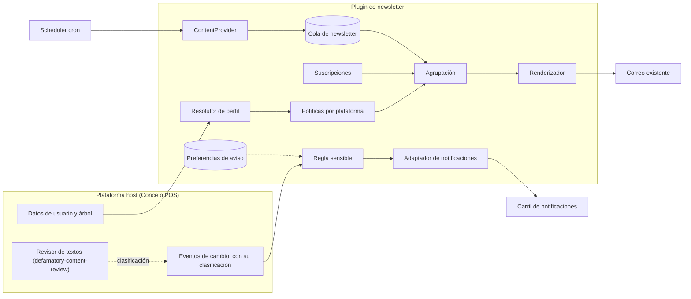
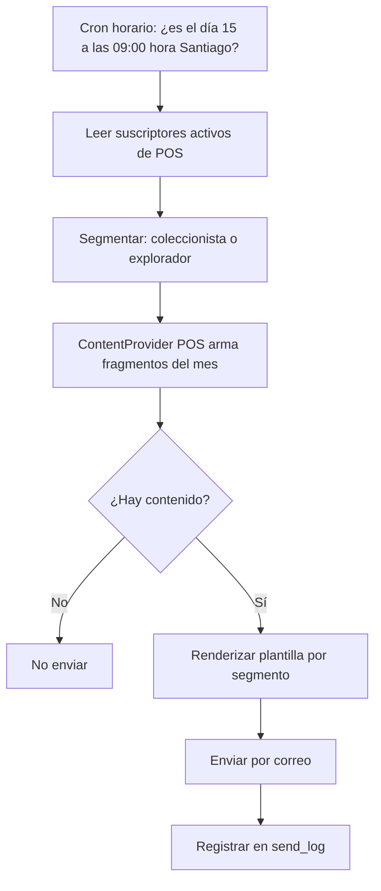
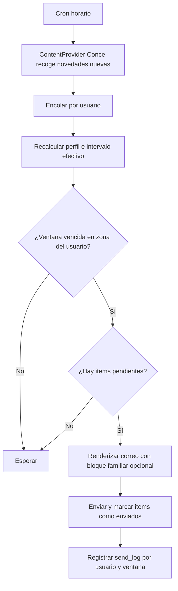
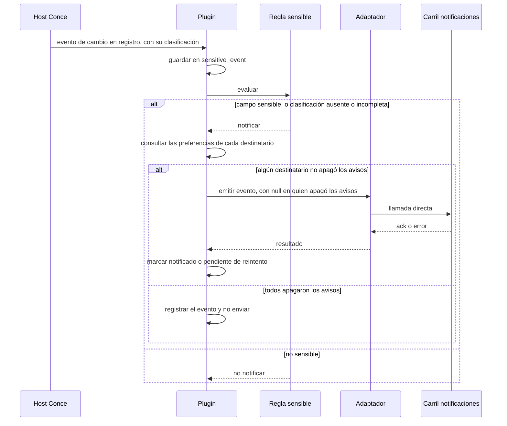

# 03 · Arquitectura común (ambos carriles)

Ambos carriles comparten la misma lógica de núcleo. Lo que cambia es la estrategia de programación y el proveedor de contenido.

## Principios
- Core agnóstico de plataforma.
- Adaptadores para todo lo externo (correo, notificaciones, datos del host). La clasificación de cambios sensibles la entrega el host con el evento (docs/05, decisión 9).
- Políticas declarativas, en docs/01-politicas.md.
- Carriles separados: newsletter con agrupación; notificaciones en tiempo real.
- Fail-closed para lo sensible.
- Sin valores de datos personales en los logs.

---

## 1. Vista general

---

## 2. Carril 1 · Newsletter POS

---

## 3. Carril 1 · Newsletter Conce

---

## 4. Carril 2 · Notificaciones Conce (tiempo real)

---

## 5. Atributos no funcionales

- **Observabilidad:** métricas de envíos, omitidos por falta de contenido, errores, notificaciones pendientes y avisos omitidos por preferencia.
- **Privacidad:** los logs no contienen valores de datos personales.
- **Resiliencia:** reintentos acotados, idempotencia y fail-closed.
- **Dependencias externas:** correo existente, carril de notificaciones (firmas propuestas en docs/02, por validar con Conce) y datos del host, que entrega también la clasificación de los cambios sensibles.
