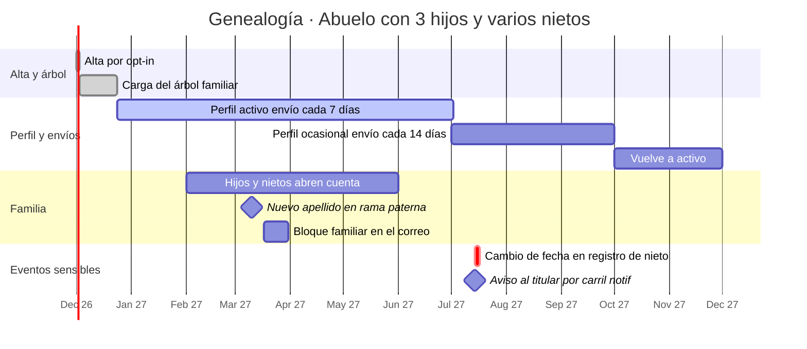

# Gantt · Conce · Genealogía · Abuelo con 3 hijos y varios nietos

**[SUPUESTO]** Caso típico. Año corrido desde el 1 de diciembre de 2026.

Escenario: un abuelo da de alta su árbol, sus hijos y nietos se suman, y el sistema le avisa a él y a su familia cuando aparece un apellido nuevo en la rama paterna.

## Notas
- El aviso de cambio sensible va por el carril de notificaciones, en tiempo real, al titular del árbol.
- Que el abuelo avise a hijos y nietos está diferido: se decide al implementar. Ver docs/00-inconsistencias.md, fila 5.
- Ilustrativo: no es el calendario de implementación; ver docs/gantt/conce-implementacion.md.
