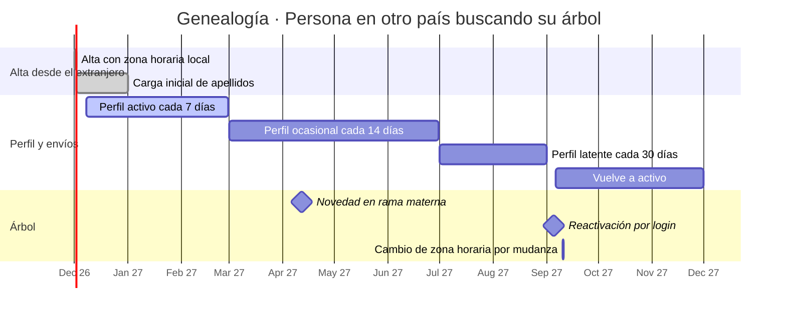

# Gantt · Conce · Genealogía · Persona en otro país buscando su árbol

**[SUPUESTO]** Caso típico. Año corrido desde el 1 de diciembre de 2026.

Escenario: una persona se da de alta desde el extranjero, carga apellidos de su familia, pasa por períodos de poca actividad y vuelve a activarse tras una mudanza.

## Notas
- El cambio de zona horaria recalcula las ventanas en la nueva zona. Ver docs/01-politicas.md, sección 7.
- Los intervalos de perfil son supuestos a calibrar.
