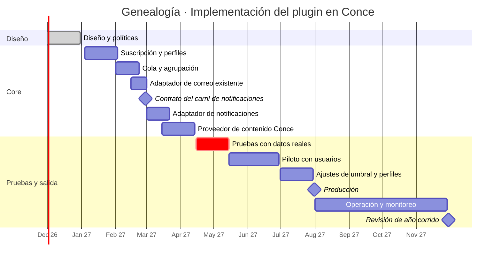

# Gantt · Conce · Implementación del plugin (referencia para el equipo)

**[SUPUESTO]** Fechas orientativas. Dependen de la resolución de las decisiones pendientes en docs/05-riesgos-y-pendientes.md.

## Notas
- El hito del contrato del carril de notificaciones es bloqueante para el adaptador. Sin él no se puede avanzar en esa parte.
- Las pruebas con datos reales dependen de validar los umbrales de perfil.
