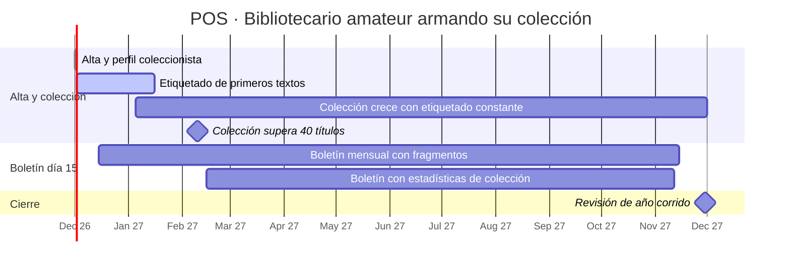

# Gantt · POS · Bibliotecario amateur armando su colección

**[SUPUESTO]** Caso típico. Año corrido desde el 1 de diciembre de 2026.

Escenario: un bibliotecario amateur etiqueta textos de forma constante, su colección crece y recibe el boletín el día 15 de cada mes con estadísticas de su colección.

## Notas
- El perfil coleccionista aparece cuando la colección supera el umbral N (a definir). El hito de 40 títulos es un supuesto.
- El boletín llega el día 15 de cada mes con independencia del ritmo de etiquetado.
