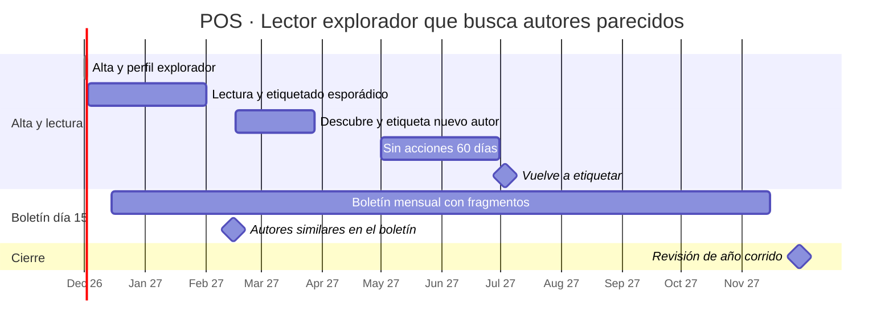

# Gantt · POS · Lector que busca autores parecidos

**[SUPUESTO]** Caso típico. Año corrido desde el 1 de diciembre de 2026.

Escenario: un lector explorador etiqueta de forma esporádica, descubre autores nuevos, deja de actuar durante un período y vuelve a etiquetar.

## Notas
- En POS el perfil no cambia la frecuencia. El boletín sigue llegando el día 15 aunque el lector deje de actuar.
- Lo que cambia es el contenido: recomendaciones de autores similares según lo que etiquetó.
- Ilustrativo: POS no tiene calendario de implementación; la fecha del 15-dic-2026 no está comprometida.
