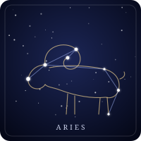

# Signos del zodiaco y horóscopo chino

Los 12 signos del zodiaco occidental y los 12 animales del horóscopo chino, en 30 idiomas. Cada uno trae su nombre, una descripción breve y otra más larga de sus supuestas características, y sus rasgos: en el occidental, símbolo, fechas tropicales y siderales, elemento y modalidad; en el chino, rama terrestre, elemento y polaridad. `zodiaco.py` calcula el signo de una fecha y el animal y el elemento de un año. Además, cada signo tiene una ilustración SVG en dos variantes: sobre cielo nocturno y transparente.

> **Aviso.** Las descripciones recogen lo que la astrología y el horóscopo chino *atribuyen* a cada signo. No hay evidencia científica de que la fecha de nacimiento influya en el carácter. Las constelaciones occidentales son figuras de la tradición, no grupos de estrellas físicamente relacionados, y los animales chinos **no tienen constelaciones**: sus figuras estelares son un dibujo hecho para este proyecto.

> **Estado de las traducciones.** Las escribió una IA y **ninguna persona nativa las ha revisado**, tampoco la versión en género neutro (ver más abajo). Antes de mostrarlas a usuarios hay que revisarlas, sobre todo en los idiomas de menos recursos (suajili, bengalí, urdu, persa, tailandés, hebreo, árabe) y los nombres de los signos en suajili. El estado de cada idioma está en `revision` de `datos/signos.json` (hoy los 30 son `sin_revisar`), sale en su ficha y en el índice de `por-idioma/`, y lo consulta `zodiaco.revision(idioma)`. Ver «Revisar una traducción».

## Contenido

| Archivo | Qué es |
|---|---|
| `datos/signos.json` | La fuente de verdad: nombres, descripciones, rasgos, fechas, troncos celestes, términos traducidos y la figura de cada signo. |
| `datos/anio-nuevo-lunar.json` | La fecha del Año Nuevo lunar de cada año, de 1900 a 2099. |
| `datos/vectores.json` | Las respuestas de `zodiaco.py` a un conjunto fijo de entradas (cada día del año, cada año de 1900 a 2099, cada par de signos…), que comparten Python y PHP. Generado, no editar a mano. |
| `CHANGELOG.md` | Historial de cambios de los datos. Su primera entrada tiene que coincidir con `version` de `datos/signos.json`. |
| `zodiaco.py` | Consultas: `signo_occidental(fecha)`, `cuspide(fecha)`, `animal_chino(anio)`, `animal_chino_de_fecha(fecha)`, `anios_del_animal(id, desde, hasta)`, `version()` y `revision(idioma)`, entre otras (ver «Uso»). |
| `php/` | El port a PHP de `zodiaco.py` (`php/src/Zodiaco.php`) y sus pruebas (`php/pruebas/ejecutar.php`). Sin dependencias. |
| `generar.py` | Valida el JSON y genera lo demás. Solo usa la biblioteca estándar de Python 3. |
| `pruebas.py` | Pruebas de los datos, las consultas y lo generado (`unittest`). |
| `pruebas_navegador.py` | Abre la galería en Chromium y la recorre en los 30 idiomas (Playwright). |
| `constelaciones/*.svg` | Una ilustración por signo (24) sobre fondo de cielo nocturno, más `conejo-vi.svg`. Generadas, no editar a mano. |
| `constelaciones-sin-fondo/*.svg` | Las mismas 25, transparentes y en `currentColor`. Generadas. |
| `por-idioma/*.md` | Una ficha por idioma (30) y un índice. Generadas, no editar a mano. |
| `galeria.html` | Página para ver las ilustraciones con su nombre y descripción en cada idioma. Generada. |

### Idiomas

Español, inglés, portugués, francés, italiano, alemán, neerlandés, sueco, polaco, ruso, ucraniano, turco, griego, árabe, hebreo, hindi, chino (simplificado), japonés, coreano, vietnamita, tailandés, indonesio, persa, urdu, bengalí, rumano, checo, finés, suajili y danés. Los códigos son ISO 639-1 y están en `IDIOMAS` de `generar.py`. Las fichas de árabe, hebreo, persa y urdu van dentro de `<div dir="rtl">`, para que GitHub y los navegadores las muestren de derecha a izquierda.

### Género neutro

Las descripciones no marcan el género de quien lee. Los rasgos van como sustantivos («Valentía, impulso y energía», no «Valiente, impulsivo y lleno de energía»), y la frase larga habla del signo, no de la persona («Signo de la iniciativa y el coraje: la tradición le atribuye…»). Se reescribieron así las de español, portugués, francés, italiano, rumano, ruso, ucraniano, polaco, checo, griego, árabe, hebreo, hindi y urdu, y las largas de alemán, neerlandés y sueco (decían «ihn», «hem», «honom»). Los demás idiomas ya eran neutros. Un adjetivo puede quedar cuando acompaña a un sustantivo («espíritu competitivo»).

### Zodiaco occidental

| Signo | Tropical | Sideral | Elemento | Modalidad |
|---|---|---|---|---|
| ♈ Aries | 21/03 – 19/04 | 14/04 – 14/05 | Fuego | Cardinal |
| ♉ Tauro | 20/04 – 20/05 | 15/05 – 14/06 | Tierra | Fijo |
| ♊ Géminis | 21/05 – 20/06 | 15/06 – 15/07 | Aire | Mutable |
| ♋ Cáncer | 21/06 – 22/07 | 16/07 – 16/08 | Agua | Cardinal |
| ♌ Leo | 23/07 – 22/08 | 17/08 – 16/09 | Fuego | Fijo |
| ♍ Virgo | 23/08 – 22/09 | 17/09 – 16/10 | Tierra | Mutable |
| ♎ Libra | 23/09 – 22/10 | 17/10 – 15/11 | Aire | Cardinal |
| ♏ Escorpio | 23/10 – 21/11 | 16/11 – 15/12 | Agua | Fijo |
| ♐ Sagitario | 22/11 – 21/12 | 16/12 – 13/01 | Fuego | Mutable |
| ♑ Capricornio | 22/12 – 19/01 | 14/01 – 12/02 | Tierra | Cardinal |
| ♒ Acuario | 20/01 – 18/02 | 13/02 – 13/03 | Aire | Fijo |
| ♓ Piscis | 19/02 – 20/03 | 14/03 – 13/04 | Agua | Mutable |

**Tropical y sideral.** El zodiaco occidental habitual es el *tropical*: los signos van atados a las estaciones. La astrología védica, la que se usa en la India, Nepal y Bangladés, usa el *sideral*, atado a las estrellas, que hoy va unos 24 días por detrás. Por eso alguien nacido el 3 de abril es Aries en el tropical y Piscis en el sideral. Los nombres en hindi y bengalí (मेष, মেষ…) son los védicos, y sus fichas muestran las dos fechas con su nombre local (सायन/निरयण, সায়ন/নিরয়ণ). Las fechas siderales siguen la entrada habitual del Sol en cada signo (ayanamsa de Lahiri) y, como las tropicales, cambian un día según el año y la hora.

Los símbolos ♈ a ♓ son U+2648 a U+2653. Algunos sistemas los pintan como emoji; para forzar el dibujo de texto, añade U+FE0E detrás.

### Horóscopo chino

Doce animales que se repiten en ciclo. Cada animal es una de las doce *ramas terrestres* (子丑寅…), y cada año combina una rama con uno de los diez *troncos celestes* (甲乙丙…): el ciclo completo dura 60 años y da el elemento del año. 2024 fue 甲辰, Dragón de Madera, y 2026 es 丙午, Caballo de Fuego.

| Animal | Rama | Elemento fijo | Polaridad | Años con su elemento (ejemplo) |
|---|---|---|---|---|
| Rata | 子 Zi | Agua | Yang | 2008 Tierra, 2020 Metal |
| Buey | 丑 Chou | Tierra | Yin | 2009 Tierra, 2021 Metal |
| Tigre | 寅 Yin | Madera | Yang | 2010 Metal, 2022 Agua |
| Conejo | 卯 Mao | Madera | Yin | 2011 Metal, 2023 Agua |
| Dragón | 辰 Chen | Tierra | Yang | 2012 Agua, 2024 Madera |
| Serpiente | 巳 Si | Fuego | Yin | 2013 Agua, 2025 Madera |
| Caballo | 午 Wu | Fuego | Yang | 2014 Madera, 2026 Fuego |
| Cabra | 未 Wei | Tierra | Yin | 2015 Madera, 2027 Fuego |
| Mono | 申 Shen | Metal | Yang | 2016 Fuego, 2028 Tierra |
| Gallo | 酉 You | Metal | Yin | 2017 Fuego, 2029 Tierra |
| Perro | 戌 Xu | Tierra | Yang | 2018 Tierra, 2030 Metal |
| Cerdo | 亥 Hai | Agua | Yin | 2019 Tierra, 2031 Metal |

El *elemento fijo* es el de la rama y no cambia; el *elemento del año* sale del tronco y es el que se usa al decir «Caballo de Fuego». No hay una lista cerrada de años: `zodiaco.animal_chino()` sirve para cualquiera, y las fichas muestran de 1924 a 2043.

**El año empieza en el Año Nuevo lunar**, que cae entre el 21 de enero y el 20 de febrero. Quien nació en enero o principios de febrero puede tener el animal del año anterior. `animal_chino_de_fecha()` lo resuelve con `datos/anio-nuevo-lunar.json`, de 1900 a 2099; `animal_chino()` sigue recibiendo directamente el año lunar y sirve para cualquier año.

Las fechas del Año Nuevo son las de la hora de China (UTC+8). Coinciden en los 200 años dos tablas independientes, las de las bibliotecas `lunardate` 0.2.2 y `LunarCalendar` 0.0.9; 2100 solo lo traía una y quedó fuera. `animal_chino_de_fecha()` pasa a esa hora un `datetime` con huso horario antes de comparar: las 20:00 UTC del 16/02/2026 ya son el 17/02 en China, año del Caballo. Una fecha o un `datetime` sin huso se toma tal cual.

Algunos idiomas usan otro animal para el mismo lugar del ciclo: en vietnamita el conejo es *Mèo* (gato) y el buey es *Trâu* (búfalo), y en japonés y coreano 羊 es la oveja (*ひつじ*, *양*) donde el español dice cabra. Para el vietnamita hay una ilustración propia del gato (`conejo-vi.svg`), que la galería usa en lugar del conejo; está en `variantes` del signo (ver el esquema).

Los 24 nombres son distintos en cada idioma, y una prueba lo comprueba: si Tauro y el Buey se llaman igual, quien lee no sabe de cuál se habla. Por eso el Buey va como búfalo en árabe (*الجاموس*), hebreo (*תאו*) y finés (*Puhveli*), donde la palabra para buey era la misma de Tauro; el búfalo ya es el animal del ciclo en vietnamita. En suajili, Capricornio es *Mbuzi wa bahari* (cabra marina, que es lo que significa) para no chocar con la Cabra china (*Mbuzi*). Estos cuatro nombres conviene que los confirme una persona nativa.

## Uso

```python
import datetime
import zodiaco

zodiaco.signo_occidental(datetime.date(1990, 4, 3))["id"]                      # 'aries'
zodiaco.signo_occidental(datetime.date(1990, 4, 3), sistema="sideral")["id"]   # 'piscis'

a = zodiaco.animal_chino(2026)
a["signo"]["nombres"]["en"], a["elemento_del_anio"]                            # ('Horse', 'fuego')
datos = zodiaco.cargar_datos()
datos["terminos"][a["elemento_del_anio"]]["ja"]                                # '火'

zodiaco.anios_del_animal("dragon", 2000, 2030)                                 # [2000, 2012, 2024]

# Desde una fecha de nacimiento: antes del Año Nuevo lunar cuenta el año anterior
zodiaco.animal_chino_de_fecha(datetime.date(2026, 2, 16))["signo"]["id"]         # 'serpiente'
zodiaco.animal_chino_de_fecha(datetime.date(2026, 2, 17))["signo"]["id"]         # 'caballo'

# Cúspide: a un día o menos de un cambio de signo, para no afirmar uno que puede estar mal
[s["id"] for s in zodiaco.cuspide(datetime.date(1990, 4, 20))]                 # ['aries', 'tauro']
zodiaco.es_cuspide(datetime.date(1990, 4, 5))                                  # False
```

Más consultas:

```python
zodiaco.nombre_del_anio(2026, "es")         # 'Caballo de Fuego'
zodiaco.nombre_del_anio(2026, "de")         # 'Feuer-Pferd'
zodiaco.nombre_del_anio(2026, "ru")         # 'Лошадь (Огонь)'  (forma genérica: ver abajo)

zodiaco.compatibilidad("rata", "dragon")    # {'relaciones': ['trino'], 'afinidad': 'alta'}
zodiaco.compatibilidad("aries", "libra")    # {'relaciones': ['elementos_complementarios', 'opuestos'], 'afinidad': 'media'}

d = zodiaco.decanato(datetime.date(1990, 4, 3))
d["numero"], d["regente"], d["signo_regente"]["id"]   # (2, 'sol', 'leo')
datos["terminos"][d["regente"]]["fr"]                 # 'Soleil'
```

- **Nombre del año** (`nombre_del_anio`): sale de `nombres_del_ciclo` en los datos, con una plantilla por idioma. Solo en español, inglés, portugués, francés, italiano, alemán, rumano, indonesio, chino y finés hay una forma fija que no depende de género o caso («Caballo de Fuego», «Fire Horse», «火马», «Tulihevonen»); en los demás es la genérica «Animal (Elemento)», y su regla lleva `"idiomatica": false` para que el producto decida si mostrarla.
- **Compatibilidad** (`compatibilidad`): las afinidades de la tradición entre dos signos del mismo zodiaco. En el occidental, mismo elemento (`alta`), elementos complementarios —fuego y aire, tierra y agua— (`alta`), opuestos (`media`) y cuadratura (`baja`); en el chino, trino 三合 y amigos secretos 六合 (`alta`) y choque 六冲 (`baja`). Lo demás es `neutra`. No tiene respaldo científico, como el resto.
- **Decanatos** (`decanato`, `regentes_de_decanatos`, `tramos_de_decanatos`): cada signo se parte en tres tramos de unos 10 días. El regente sigue el orden caldeo (Marte, Sol, Venus, Mercurio, Luna, Saturno, Júpiter, desde Aries), y `signo_regente` el sistema por triplicidad (los tres signos del mismo elemento). Las fichas los muestran con el nombre del astro en cada idioma.

Las funciones devuelven los diccionarios de `datos/signos.json` tal cual y lanzan excepción si la entrada no es válida (`TypeError` si la fecha no es `datetime.date` o el año no es `int`, `ValueError` si el sistema, el idioma o el signo no existen, o si se comparan signos de zodiacos distintos).

```sh
python3 generar.py              # regenera constelaciones/, constelaciones-sin-fondo/, por-idioma/ y galeria.html
python3 generar.py --comprobar  # falla si lo committeado no coincide con datos/signos.json
python3 -m unittest -v pruebas  # pruebas
php php/pruebas/ejecutar.php    # el port a PHP contra datos/vectores.json
python3 pruebas_navegador.py    # la galería en Chromium (necesita playwright==1.55.0)
```

Para cambiar un nombre, una descripción, una estrella o una figura, edita `datos/signos.json`, ejecuta `python3 generar.py` y revisa el diff de los archivos generados. `--comprobar` también falla si queda un archivo en las carpetas generadas que ya nadie genera.

Las pruebas comprueban, entre otras cosas, que los dos zodiacos cubran el año bisiesto sin huecos ni solapes, el ciclo de 60 años (1900 Rata de Metal, 2024 Dragón de Madera, 2026 Caballo de Fuego), que cada texto esté en el alfabeto de su idioma (detectan un texto pegado en la columna equivocada) y que las descripciones en español no vuelvan a los adjetivos con género. `pruebas_navegador.py` abre la galería en Chromium y, en los 30 idiomas y las dos variantes, comprueba que no haya errores de JavaScript, que carguen las 24 imágenes, que la interfaz salga en el idioma elegido, que árabe, hebreo, persa y urdu vayan de derecha a izquierda y que el vietnamita use el gato. Necesita `pip install playwright==1.55.0` (con `PLAYWRIGHT_SKIP_BROWSER_DOWNLOAD=1`, no baja navegadores) y un Chromium: el de la variable `CHROMIUM` o el primero que encuentre.

Todo corre en CI (`.github/workflows/pruebas-signos-zodiacales.yml`) cuando cambia esta carpeta; la galería, en un job aparte.

### PHP

`php/src/Zodiaco.php` es la misma biblioteca en PHP (8.1 o más), sin Composer ni dependencias: `require 'php/src/Zodiaco.php';` y `SignosZodiacales\Zodiaco::…`. Lee los mismos `datos/*.json` y devuelve los mismos arrays.

```php
use SignosZodiacales\Zodiaco;

Zodiaco::signoOccidental(new DateTimeImmutable('1990-04-03'))['id'];             // 'aries'
Zodiaco::signoOccidental(new DateTimeImmutable('1990-04-03'), 'sideral')['id'];  // 'piscis'
Zodiaco::animalChino(2026)['elemento_del_anio'];                                 // 'fuego'
Zodiaco::animalChinoDeFecha(new DateTimeImmutable('2026-02-16'))['signo']['id']; // 'serpiente'
Zodiaco::nombreDelAnio(2026, 'es');                                              // 'Caballo de Fuego'
Zodiaco::compatibilidad('rata', 'dragon')['afinidad'];                           // 'alta'
```

Los nombres pasan a camelCase (`signo_occidental` → `signoOccidental`, `anios_del_animal` → `aniosDelAnimal`) y hay una diferencia a propósito: Python distingue un `date` de un `datetime` con huso horario, y PHP no distingue una fecha «sin huso» de otra con huso. Por eso `animalChinoDeFecha()` toma el día de la fecha en su propio huso, y **`animalChinoDeInstante()`** la pasa antes a la hora de China, como hace Python con un `datetime` con huso. Las entradas no válidas lanzan `InvalidArgumentException` (o `TypeError`, por los tipos estrictos).

**Los dos se prueban contra los mismos vectores.** `generar.py` calcula con `zodiaco.py` las respuestas a unas 3 700 entradas y las guarda en `datos/vectores.json`; `python3 generar.py --comprobar` falla si el archivo no está al día, y `php php/pruebas/ejecutar.php` falla si PHP da una sola respuesta distinta. Si cambias una consulta de Python, regenera los vectores y el port tiene que seguirla (el diff de `vectores.json` dice qué cambió). El primer día que se probó, los vectores atraparon un fallo del port: dos signos del mismo elemento contaban también como «elementos complementarios».

### Versión y revisión

`datos/signos.json` lleva `version` (versionado semántico: mayor si cambia el esquema o lo que devuelven las consultas, menor si se agregan datos o funciones, parche si se corrige un texto) y `CHANGELOG.md` cuenta qué cambió. `generar.py --comprobar` falla si la primera entrada del `CHANGELOG.md` no coincide con `version`: no se puede cambiar una sin la otra.

**Revisar una traducción.** Cuando una persona nativa revise un idioma, cambia su entrada en `revision` de `datos/signos.json`:

```json
"es": { "estado": "revisado", "por": "Nombre Apellido", "fecha": "2026-10-26" }
```

`por` y `fecha` (AAAA-MM-DD) son obligatorios si el estado es `revisado`. Luego `python3 generar.py` actualiza la ficha y el índice, y se apunta en `CHANGELOG.md` (versión menor, o parche si solo cambia esto) con la misma versión en `datos/signos.json`.

## Esquema de `datos/signos.json`

```jsonc
{
  "version": "1.1.0",                                               // la de CHANGELOG.md
  "revision": { "es": { "estado": "sin_revisar" }, … },             // los 30 idiomas; «revisado» lleva «por» y «fecha»
  "terminos": { "fuego": { "es": "Fuego", "en": "Fire", … }, … },   // elementos, modalidades, yin/yang, los 7 astros
                                                                    // y los textos de la galería y las fichas × 30 idiomas
  "nombres_del_ciclo": { "es": { "plantilla": "{animal} de {elemento}", "idiomatica": true }, … },
                       // también "elision" (fr, it: «d'Eau») y "elementos" (de: «Erd-Ochse»)
  "troncos": [ { "hanzi": "甲", "pinyin": "Jia", "elemento": "madera", "polaridad": "yang" }, … ],  // los 10, en orden
  "signos": [
    {
      "id": "aries",                  // único; es el nombre del SVG
      "tipo": "occidental",           // o "chino"
      "simbolo": "♈",                 // solo occidental
      "tropical": { "desde": [3, 21], "hasta": [4, 19] },   // [mes, día]; solo occidental
      "sideral":  { "desde": [4, 14], "hasta": [5, 14] },
      "elemento": "fuego",            // clave de "terminos"; en el chino, el elemento fijo de la rama
      "modalidad": "cardinal",        // solo occidental
      // solo chino: "rama": { "hanzi": "子", "pinyin": "Zi" }, "polaridad": "yang"
      "nombres":              { "es": "Aries", … },     // 30 idiomas
      "descripciones":        { "es": "Valentía, …", … },
      "descripciones_largas": { "es": "Signo de …", … },
      "constelacion": { "estrellas": [[x, y], …], "lineas": [[i, j], …] },  // viewBox 200×200
      "figura": ["M64 92 C60 66 …", …],                 // trazos SVG ("d"); los que acaban en Z se rellenan
      "variantes": { "vi": { "constelacion": {…}, "figura": […] } }  // opcional: otra ilustración para un idioma
    }
  ]
}
```

Los signos chinos van en el orden del ciclo (Rata primero) y `zodiaco.py` depende de ese orden; lo comprueban las pruebas. Los campos se validan en `generar.validar()`. Cualquier cambio de esquema debe tocar ahí, en las pruebas y en este README.

## Las ilustraciones

Son **esquemas** de 200×200 unidades dibujados a mano: la figura (en trazo fino) y las estrellas (unidas por líneas) se ven bien juntas, pero no están a escala, no tienen magnitud ni distancia real, y no son las coordenadas astronómicas de las estrellas.

- `constelaciones/`: sobre un cuadro de cielo nocturno, con un fondo de estrellas y brillo en las principales. Los ids internos son únicos por archivo (`fondo-aries`, `brillo-aries`), así que se pueden incrustar varios en una misma página.
- `constelaciones-sin-fondo/`: transparente, sin colores fijos y sin ids. Todo se pinta en `currentColor`, así que toma el color del texto que lo rodea y sirve en tema claro, en tema oscuro o como icono.
- `galeria.html`: las 25 ilustraciones con un selector de idioma y de variante. No carga nada de fuera; ábrela desde esta carpeta para que encuentre los SVG. Toda la página cambia al idioma elegido —título, selectores, secciones, nombres y descripciones—, con dirección de derecha a izquierda en árabe, hebreo, persa y urdu.

**No llevan texto.** No tienen etiqueta, `<title>` ni `<desc>`, para que un lector de pantalla no lea español a quien usa otro idioma. El nombre accesible lo pone quien muestra el SVG, con `nombres[idioma]`:

```html


<!-- Incrustado: role y etiqueta en el idioma de quien lo ve -->
<svg role="img" aria-label="Овен" viewBox="0 0 200 200">…</svg>

<!-- Variante sin fondo, incrustada: toma el color del CSS -->
<span style="color: #8a6d3b"><svg role="img" aria-label="Aries" viewBox="0 0 200 200">…</svg></span>
```

`currentColor` solo hereda el color cuando el SVG está incrustado en el HTML. Dentro de un `` se pinta negro.

El fondo de estrellas y el tamaño de cada estrella salen de `generar.numeros()`, que usa SHA-256 y no depende de la versión de Python: el resultado es el mismo en cada ejecución y en cada máquina, y una prueba fija sus primeros valores. Las estrellas de fondo son puntos agrupados por brillo y tamaño en unos pocos trazos, así que cada SVG con fondo pesa unos 3,5 KB; una prueba avisa si alguno pasa de 4,5 KB.
